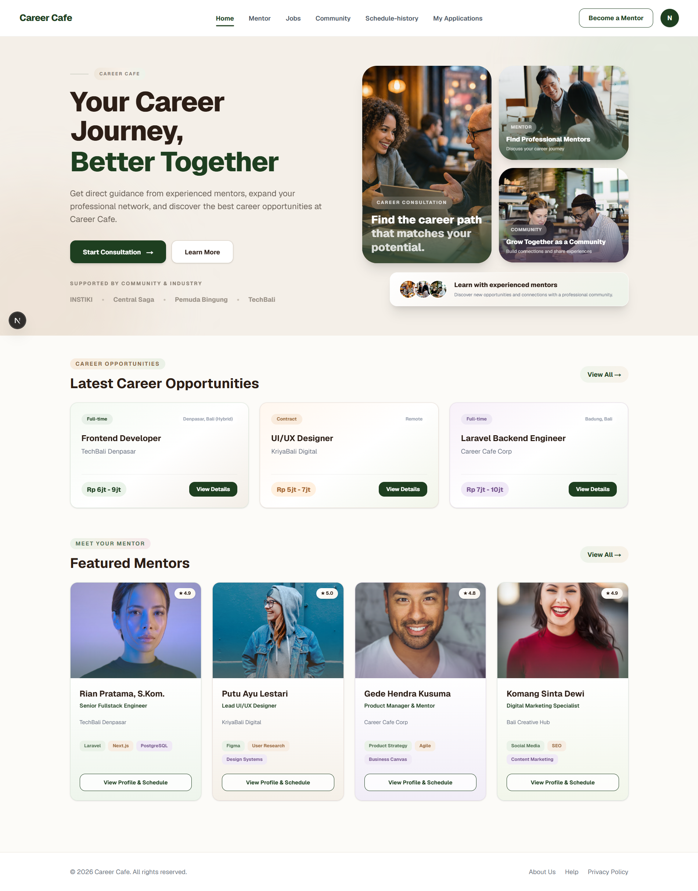

# Career Café

Career Café adalah platform pengembangan karier yang menghubungkan mentee dengan mentor profesional. Pengguna dapat mencari mentor, mengatur sesi mentoring, mengeksplorasi lowongan kerja, mengajukan lamaran, dan berbagi informasi karier.

## Fitur Utama

- Registrasi dan login pengguna.
- Pengelolaan profil mentee dan mentor.
- Pencarian mentor dan keahlian.
- Pengaturan jadwal dan ketersediaan mentor.
- Sesi mentoring dan feedback.
- Komunitas karier.
- Pencarian lowongan dan pengajuan lamaran.
- Pengajuan menjadi mentor beserta dokumen pendukung.
- Administrasi mentee, sesi, laporan, dan pengajuan mentor.

## Teknologi

- Frontend: Next.js 16, React 19, TypeScript.
- Backend: Laravel 13, PHP.
- Autentikasi API: Laravel Sanctum.
- Database: PostgreSQL 15.
- Container: Docker Compose.

## Struktur Repository

- `backend/`: aplikasi API Laravel, migration, dan seeder.
- `frontend/`: aplikasi web Next.js.
- `docker-compose.yml`: konfigurasi layanan Docker.
- `README.md`: dokumentasi proyek.

## Persyaratan

- Git.
- Docker dan Docker Compose.
- Browser modern.

## Instalasi

### 1. Clone repository

`git clone https://github.com/Central-Saga/Trio-Project2-CareerCafe.git`

Masuk ke direktori hasil clone sebelum melanjutkan konfigurasi.

### 2. Konfigurasi environment

Jalankan dari root repository. Perintah berikut hanya membuat file jika belum ada:

- ` [ -f .env ] || cp .env.example .env `
- ` [ -f backend/.env ] || cp backend/.env.example backend/.env `
- ` [ -f frontend/.env.local ] || cp frontend/.env.example frontend/.env.local `

Pastikan `POSTGRES_PASSWORD` pada `.env` diisi dengan password lokal. Jangan commit file environment.

### 3. Menjalankan aplikasi

Jalankan langkah berikut secara berurutan:

1. Start database: `docker compose up -d postgres`
2. Install dependency backend: `docker compose run --build --rm backend composer install`
3. Buat application key untuk instalasi baru: `docker compose run --rm backend php artisan key:generate`
4. Buat tabel dan data demo: `docker compose run --rm backend php artisan migrate --seed`
5. Build dan start aplikasi: `docker compose up -d --build`
6. Periksa layanan: `docker compose ps`

Pastikan port `3000` dan `8000` tersedia. Jangan menghapus volume database untuk mengatasi masalah koneksi.

### 4. Alamat aplikasi

| Layanan | Alamat |
|---|---|
| Frontend | http://localhost:3000 |
| Backend | http://localhost:8000 |
| API | http://localhost:8000/api |

Alamat tersebut merupakan alamat lokal yang direncanakan. Pastikan port tidak sedang digunakan layanan lain.

## Akun Demo

Akun di bawah ini tercantum dalam `backend/database/seeders/DatabaseSeeder.php`. Password demo adalah `password123`.

| Role | Email |
|---|---|
| Mentee | `trioriawan@example.com` |
| Mentor | `rian.pratama@careercafe.test` |
| Mentor | `putu.ayu@careercafe.test` |
| Mentor | `gede.hendra@careercafe.test` |
| Mentor | `komang.sinta@careercafe.test` |

Jalankan seeder sebelum memakai akun tersebut. Seeder yang diperiksa tidak mendefinisikan akun admin demo. Kredensial di atas hanya untuk pengujian lokal, bukan produksi.

## Pengembangan dan Troubleshooting

- Periksa status container dengan `docker compose ps`.
- Periksa log backend dengan `docker compose logs backend`.
- Periksa log frontend dengan `docker compose logs frontend`.
- Pastikan API dapat diakses dan `NEXT_PUBLIC_API_URL` sesuai dengan alamat backend.
- Pastikan koneksi database menggunakan host, nama database, username, dan password yang benar.
- Jalankan test backend menggunakan `php artisan test` dari lingkungan backend yang telah terkonfigurasi.

Hentikan layanan tanpa menghapus volume database menggunakan `docker compose down`. Hindari `docker compose down -v` apabila data database masih dibutuhkan.

## Keamanan

- Jangan commit `.env`, `.env.local`, application key, token, atau password asli.
- Jangan gunakan kredensial demo untuk produksi.
- Simpan backup sebelum melakukan perubahan database yang berisiko.

## Screenshot

### Halaman Utama

## Lisensi

Periksa ketentuan lisensi proyek sebelum menggunakan atau mendistribusikan aplikasi.
